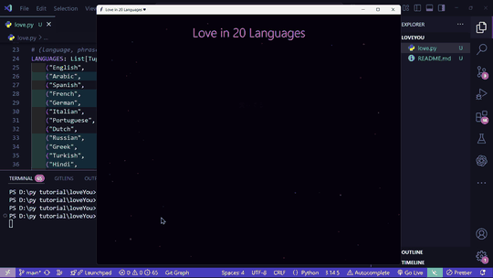

# Multilingual Love Heart ❤️

A Python animation that reveals a neon heart made from “I love you” in 20 languages, followed by the message “One feeling, 20 languages.”

## Preview



## Features

- Fits complete phrases inside a parametric heart shape.
- Reveals the title and phrases with a glowing, animated effect.
- Adds a soft heart halo, heartbeat pulse, and drifting sparkles.
- Supports fullscreen mode and configurable animation speed and phrase layout.
- Uses Python’s standard library and `tkinter`; no third-party packages are needed.

## Requirements

- Python 3.8 or newer
- `tkinter` (included with most Windows and macOS Python installers; on Debian or Ubuntu, install with `sudo apt install python3-tk`)

## Run

From the project directory:

```bash
python love.py
```

## Options

```bash
python love.py --fullscreen
python love.py --speed 1.5 --seed 12
python love.py --rtl visual
```

- `--fullscreen`: start in fullscreen mode.
- `--speed`: set the animation speed (default: `1.0`; must be positive).
- `--seed`: set the phrase arrangement seed (default: `7`).
- `--rtl`: choose `logical` (default) or `visual` phrase rendering for Arabic, Persian, and Urdu. Use `visual` with Tk builds that do not support bidirectional text.

Press **R** to replay, **F11** or **F** to toggle fullscreen, and **Esc** or **Q** to quit. You can also press **Ctrl+C** in the terminal running the program.
